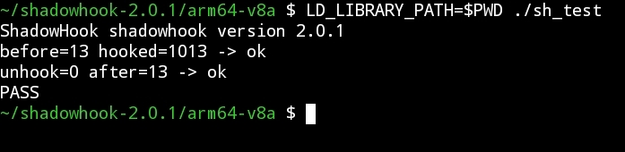

# ShadowHook builder

A GitHub Actions workflow that builds [ShadowHook](https://github.com/bytedance/android-inline-hook)
(`libshadowhook.so` + AAR) for any released version. The source archive URL is resolved
automatically from the version tag.



## Files

| File | Purpose |
|---|---|
| `.github/workflows/build.yml` | the build (`workflow_dispatch`) |
| `test.c` | self-test: hooks its own function, checks the result, unhooks |
| `README.md` | this file |
| `screenshot_2026-10-19_com.termux.jpg` | example of a passing test run |

## Usage

**Actions → Build ShadowHook → Run workflow**

- `version`: `2.0.1`, `v2.0.1` or `latest` (default)
- `java`: JDK used by Gradle (default 17; older 1.x versions may need 11)
- `release`: also publish the result as a GitHub Release (`shadowhook-<version>`)

What it does: resolves the tag → downloads `.../archive/refs/tags/v<version>.zip` →
runs `./gradlew :shadowhook:assembleRelease` → extracts the `.so` files from the AAR →
builds `test.c` with the NDK for `arm64-v8a` and `armeabi-v7a`.

## Output (artifact `shadowhook-<version>`)

```
shadowhook-release.aar
shadowhook.h
arm64-v8a/    libshadowhook.so  libshadowhook_nothing.so  sh_test
armeabi-v7a/  libshadowhook.so  libshadowhook_nothing.so  sh_test
```

## Testing on a device

Copy the folder somewhere executable (not `/sdcard`):

```sh
# adb
adb push arm64-v8a /data/local/tmp/sh
adb shell 'cd /data/local/tmp/sh && chmod +x sh_test && LD_LIBRARY_PATH=. ./sh_test'

# or Termux
cp -r arm64-v8a ~/sh && cd ~/sh
chmod +x sh_test && LD_LIBRARY_PATH=$PWD ./sh_test
```

The output should end with `PASS` (see the screenshot above).

`libshadowhook_nothing.so` is required by the library itself: during `init` it `dlopen`s it
to locate offsets inside the linker's structures. Without it you get
`FAIL init: 12 (Init linker mod failed)`. `LD_LIBRARY_PATH` tells the loader where to find it.
